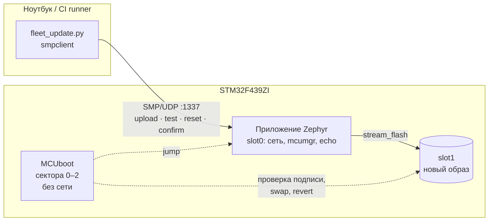
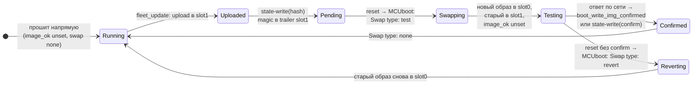
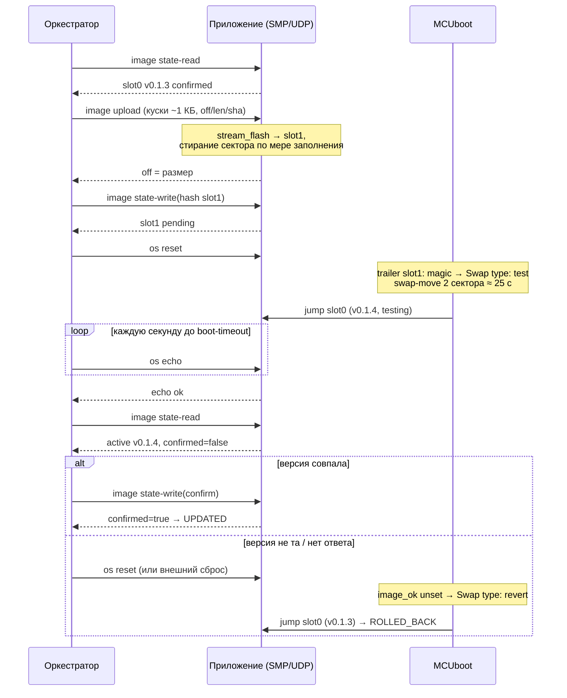

# sber-ota — обновление прошивки STM32 по Ethernet (Zephyr + MCUboot + mcumgr)

Прототип для парка сервисных контроллеров (~15–20 плат): прошивка приходит по сети,
плата сама проверяет подпись, запускает новый образ «на пробу» и **откатывается на
предыдущий, если он не доказал работоспособность**. Один скрипт обновляет весь парк.

Проверено на железе: NUCLEO-F439ZI (STM32F439ZI, Cortex-M4, 2 МБ dual-bank flash, LAN8742A).

| Что сделано | Результат на стенде |
|---|---|
| Запись во второй банк flash при живой сети (read-while-write) | стирание 7 × 128 КБ + запись 896 КБ: **0 потерь UDP, RTT не изменился** |
| MCUboot (swap-move, ECDSA P-256) + подписанное приложение | загрузчик 30 КБ, приложение стартует из slot0 (`VTOR=0x08020400`) |
| Обновление по UDP через mcumgr/SMP | 218 КБ за 10 с, swap ~25 с, весь цикл с проверкой и подтверждением **47 с** |
| Откат неподтверждённого образа | второй сброс → `Swap type: revert` → предыдущая версия |
| «Плохой» образ (слушает чужой IP) | скрипт не дождался ответа → внешний сброс → MCUboot откатил сам |
| Групповое обновление | `tools/fleet_update.py`: параллельно по списку плат, SKIPPED / UPDATED / ROLLED_BACK / UNREACHABLE |

---

## 1. Архитектура и почему так



**Сеть живёт в приложении, загрузчик — без сети.** MCUboot маленький (30 КБ): читает trailer,
проверяет подпись выбранного слота, при необходимости меняет слоты местами и прыгает.
Приём образа, запись во flash и перезагрузка — задача приложения. Так загрузчик почти
невозможно сломать обновлением, а стек TCP/IP не дублируется.

**Zephyr + MCUboot + mcumgr, а не свой загрузчик на HAL.** Механика (заголовок образа, trailer,
swap, подпись, защита от потери питания) взята из проверенной реализации; своё — раскладка
flash под dual-bank F4, политика подтверждения, оркестратор парка, измерения.

**swap-move сейчас, direct-XIP — дальше.** На STM32F4 dual-bank ≠ swap адресов (бит `BFB2`
только меняет точку входа ROM-загрузчика; банк 2 остаётся по `0x08100000`). Поэтому либо
образ копируется в slot0 (swap-move — работает, см. ниже), либо собирается два образа под
разные адреса (direct-XIP — следующий шаг, раскладка под него уже симметричная).

**UDP + SMP, а не TCP.** Надёжность у SMP своя: запрос–ответ, идемпотентные куски с `off`,
повтор с того же места. TCP добавил бы состояние и ничего не дал бы на одном сегменте сети.
Цена stop-and-wait при RTT ~0,6 мс — ноль; узкое место — flash, не сеть.

**Подтверждает образ не факт загрузки, а ответ по сети.** Образ, который загрузился и молчит,
для парка бесполезен и недостижим для исправления по воздуху. Поэтому:
- прошивка подтверждает себя (`boot_write_img_confirmed`) после **первого отвеченного
  UDP-запроса** (`CONFIG_SBER_OTA_AUTO_CONFIRM`, выключается для демо отката);
- оркестратор проверяет здоровье **через SMP `os echo`** (не через UDP echo), сверяет версию
  и только потом подтверждает — решение «confirm или откат» принимает он.

## 2. Раскладка flash (STM32F439ZI, 2 МБ, два банка)

```
Bank 1                                        Bank 2
0x08000000 ┌──────────────────┐ сектора 0–2   0x08100000 ┌──────────────────┐ сектора 12–16
           │ MCUboot   48 КБ  │ (3 × 16 КБ)              │ зеркало 0–4      │ не используются
0x0800C000 ├──────────────────┤ сектор 3                 │                  │
           │ boot-state 16 КБ │ резерв под конфиг        │                  │
0x08010000 ├──────────────────┤ сектор 4      0x08120000 ├──────────────────┤ сектора 17–23
           │ reserved  64 КБ  │                          │ slot1  896 КБ    │ (7 × 128 КБ)
0x08020000 ├──────────────────┤ сектора 5–11             │ новый образ      │
           │ slot0   896 КБ   │ (7 × 128 КБ)             │                  │
           │ активный образ   │                          │                  │
           │ (+trailer)       │                          │ (+trailer)       │
0x08100000 └──────────────────┘               0x08200000 └──────────────────┘
```

- Слоты симметричны (одинаковые смещения внутри банков) — секторная структура совпадает,
  это нужно и swap-move, и будущему direct-XIP. Дефолтные partitions платы (32 КБ под
  загрузчик, слоты 896/768) не кратны секторам — свой overlay
  [`boards/nucleo_f439zi.overlay`](boards/nucleo_f439zi.overlay), один файл для приложения
  и для MCUboot ([`sysbuild/mcuboot.overlay`](sysbuild/mcuboot.overlay) его включает).
- swap-move при равном числе секторов оставляет последний сектор primary под сдвиг и
  trailer: полезный объём образа ≈ 767 КБ (приложение сейчас 218 КБ).
- Dual-bank даёт **read-while-write**: стирание и запись банка 2 не останавливают код в
  банке 1. Измерено, см. §4.

## 3. Жизненный цикл образа



Последовательность одного обновления (так работает `fleet_update.py`):



## 4. Измерения

Стенд: ноутбук ↔ плата напрямую через USB-Ethernet адаптер, 100 Мбит full-duplex,
статика `192.168.7.2` ↔ `192.168.7.1`.

**Read-while-write** (`tools/rww_test.py`: UDP echo каждые 20 мс, параллельно shell-команды
`rww erase|write|verify` стирают и пишут slot1 из работающего приложения):

| Фаза | Длительность | Пакетов | Потерь | RTT avg / p99 / max, мс |
|---|---|---|---|---|
| baseline | 3,0 с | 151 | 0 | 0,64 / 1,04 / 1,08 |
| erase 7 × 128 КБ | 13,5 с (1,9 с/сектор) | 673 | 0 | 0,63 / 1,09 / 1,49 |
| write 896 КБ | 15,6 с (57 КБ/с) | 782 | 0 | 0,65 / 1,10 / 1,42 |
| after | 3,0 с | 150 | 0 | 0,64 / 0,96 / 1,04 |

Драйвер `flash_stm32` ждёт BSY в busy-loop без запрета прерываний, поэтому сетевые потоки
вытесняют поток, который стирает. Без dual-bank каждый сектор замораживал бы ядро на 1,9 с.

**Обновление** (образ 218 КБ, два сектора по 128 КБ в каждом слоте):

| Этап | Время |
|---|---|
| upload по SMP/UDP (с прогрессивным стиранием) | 9,9 с (≈22 КБ/с по часам) |
| swap-move в MCUboot (сдвиг + обмен 2 секторов) | ≈25 с |
| echo → сверка версии → confirm | ≈2 с |
| **весь цикл `fleet_update.py` на одну плату** | **47 с** |
| негативный сценарий: 60 с ожидания + внешний сброс + revert | 1 мин 55 с |

Узкое место — стирание flash (1,9 с на сектор 128 КБ), а не сеть. Для парка платы
обновляются параллельно, время почти не растёт с их числом.

## 5. Как собрать, прошить, обновить

Окружение: Windows 11 нативно, Zephyr `main` (v4.5.0-rc1+), MCUboot v2.4.0+, SDK 1.0.1,
Python 3.12 в venv `C:\dev\zephyrproject\.venv`. Приложение лежит в workspace как
`C:\dev\zephyrproject\app\sber-ota`; команды — из `C:\dev\zephyrproject` с активированным venv.

```powershell
# сборка MCUboot + подписанное приложение (sysbuild)
west build -b nucleo_f439zi --sysbuild app/sber-ota -d build_sber_sb

# прошивка обоих образов через ST-Link (STM32CubeProgrammer)
west flash -d build_sber_sb

# версия берётся из файла VERSION → заголовок образа и imgtool sign
.\.venv\Scripts\imgtool.exe verify -k bootloader\mcuboot\root-ec-p256.pem build_sber_sb\sber-ota\zephyr\zephyr.signed.bin
```

Консоль — COM-порт ST-Link, 115200. При старте приложение печатает версию, `VTOR`,
состояние образа (`confirmed` / `testing`) и partitions из Device Tree.

```powershell
# инвентарь парка и обновление
$env:PYTHONUTF8 = "1"
python app/sber-ota/tools/fleet_update.py inventory --boards 192.168.7.1,192.168.7.2
python app/sber-ota/tools/fleet_update.py update --boards-file boards.txt `
    --image build_sber_sb/sber-ota/zephyr/zephyr.signed.bin

# то же руками, через smpmgr
smpmgr --ip 192.168.7.1 image state-read
smpmgr --ip 192.168.7.1 image upload zephyr.signed.bin
smpmgr --ip 192.168.7.1 image state-write <hash slot1>     # пометить на пробу
smpmgr --ip 192.168.7.1 os reset                            # swap → testing
smpmgr --ip 192.168.7.1 image state-write --confirm         # или не подтверждать → откат при следующем сбросе

# сброс с логом MCUboot в консоли (порт открывается до сброса)
.\app\sber-ota\tools\reset_capture.ps1 -Seconds 60
```

Демо отката: собрать «плохой» образ (слушает чужой IP) в отдельную папку и скормить скрипту —
он не дождётся ответа, а MCUboot откатит образ при следующем сбросе:

```powershell
west build -p always -b nucleo_f439zi --sysbuild app/sber-ota -d build_sber_bad -- "-Dsber-ota_EXTRA_CONF_FILE=tools/demo-bad-ip.conf"
python app/sber-ota/tools/fleet_update.py update --boards 192.168.7.1 --boot-timeout 60 `
    --image build_sber_bad/sber-ota/zephyr/zephyr.signed.bin `
    --on-unreachable-cmd '"C:\Program Files\STMicroelectronics\STM32Cube\STM32CubeProgrammer\bin\STM32_Programmer_CLI.exe" -c port=swd reset=HWrst -rst'
```

Проверка RWW: прошить, затем `python app/sber-ota/tools/rww_test.py --port COM10`.

> **Ключ подписи** — тестовый `root-ec-p256.pem` из репозитория MCUboot, он публично известен.
> Боевой ключ задаётся через `SB_CONFIG_BOOT_SIGNATURE_KEY_FILE` и в репозиторий не попадает.

## 6. Структура

```
CMakeLists.txt              приложение: src/main.c + src/rww_test.c
Kconfig                     CONFIG_SBER_OTA_AUTO_CONFIRM (политика подтверждения)
prj.conf                    сеть (IPv4 статика), flash_map, shell, mcumgr/SMP по UDP, img/os_mgmt
VERSION                     версия → заголовок образа (imgtool), APP_VERSION_* в коде
sysbuild.conf               MCUboot: swap-move, ECDSA P-256
sysbuild/mcuboot.overlay    те же partitions + chosen code-partition = boot_partition
boards/nucleo_f439zi.overlay  раскладка flash под dual-bank (единственный источник)
src/main.c                  UDP/TCP echo, лог состояния образа, автоподтверждение
src/rww_test.c              shell: rww info|erase|write|verify (slot1 при живой сети)
tools/fleet_update.py       групповое обновление (smpclient)
tools/rww_test.py           измерение RTT/потерь во время стирания flash
tools/reset_capture.ps1     os reset + лог консоли одной командой
tools/demo-bad-ip.conf      «плохой» образ для демо отката
tools/boards.example.txt    пример списка плат
```

Грабли окружения (Windows, CMake из mingw ломает линковку, Defender, `sysbuild/mcuboot.overlay`
отключает собственный overlay MCUboot, кодировка консоли у `smpmgr` и т. п.) — в заметках проекта.

## 7. Что дальше

- direct-XIP (`SB_CONFIG_MCUBOOT_MODE_DIRECT_XIP_WITH_REVERT`): два образа под адреса слотов,
  без копирования — обновление быстрее на ~25 с; раскладка уже под это.
- Аппаратный watchdog (IWDG): зависший образ → сброс → MCUboot откатывает неподтверждённый.
- DHCP + mDNS: discovery плат для скрипта вместо списка IP.
- CI: сборка + подпись в облаке, заливка через self-hosted runner с платой (hardware-in-the-loop).
- Зафиксировать релизный тег Zephyr/MCUboot (сейчас `main`).
